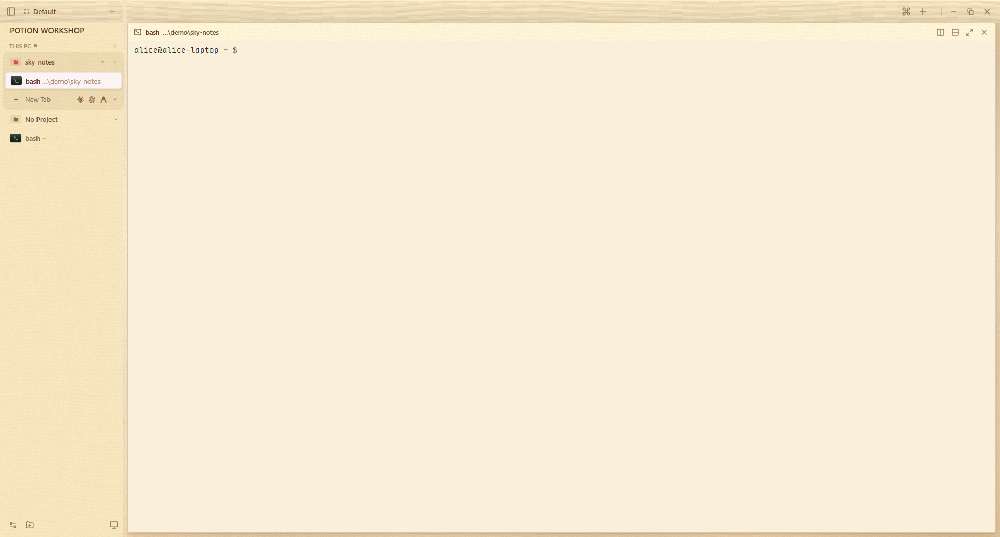

# Potion Workshop

A theme pack for [GoRex](https://github.com/si-mods/gorex): a warm fairy-tale apothecary on paper: parchment with fibers and grain, slow gold motes, a wooden shelf, potion bottles and a small slime. Light and dark.




The look follows the "Potion Workshop" preset of [codex-themes](https://github.com/freestylefly/codex-themes). The pack holds no image, code or text of that project: every picture in it is new art, drawn by the shaders in `assets/`. See [NOTICE](NOTICE).

## What it sets

- Seeds: the light and dark palettes of the preset.
- Shaders: the window background (parchment, lamp glow, motes, bottles and slime), the title bar as a wooden shelf, the sidebar column as paper, and the chosen row and pane header as paper with a dashed stitch along the edge.
- Roles: paper tones for the faces in each appearance, `pane.border` in brown.
- Metrics: corner scale 0.5, 1 DIP borders, rounded then Segoe UI, hard shadows.
- Glass off. Terminal: Lumina Parchment Light and Lumina Parchment Dark. Wordmark: POTION WORKSHOP.

## Install

GoRex with theme shaders (docs/DSK-012-theme-shaders.md, phase 2) is needed. An older build loads the colors and drops the shaders, with warnings.

```sh
git clone https://github.com/si-mods/gorex-theme-potion-workshop
gorex pack install gorex-theme-potion-workshop
```

Then select **Potion Workshop** on the Extensions page of the settings, or set `"appearance.theme": "gorex-theme-potion-workshop"` in `settings.json`.

## Checks

Every shader passes GoRex's checks at load with no warning: `Fragment` only, no backdrop read, constant loops (at most 6 runs a pixel), cost under 8 times the built-in background, and text contrast on each face (4.5:1 for text, 3:1 for muted text, in both appearances).

## License

MIT, see [LICENSE](LICENSE).
