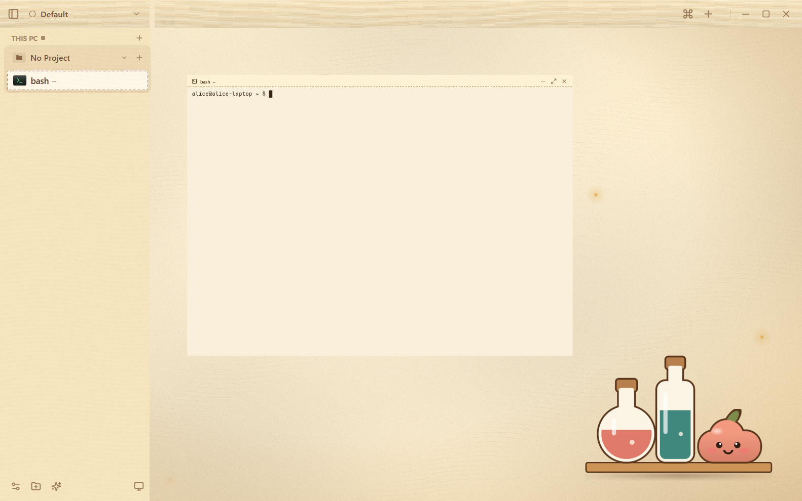
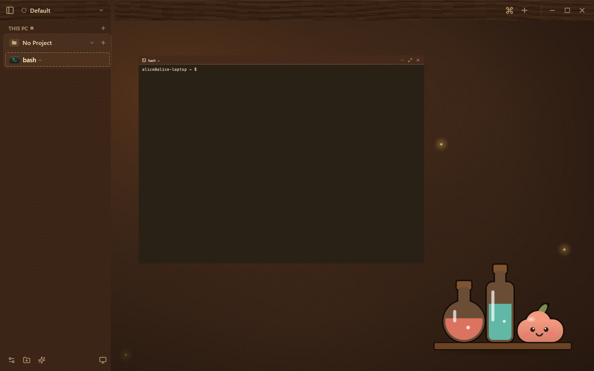

# Potion Workshop

A theme pack for [GoRex](https://github.com/si-mods/gorex): a warm fairy-tale apothecary on paper: parchment with fibers and grain, slow gold motes, a wooden shelf, potion bottles and a small slime. Light and dark.





The look follows the "Potion Workshop" preset of [codex-themes](https://github.com/freestylefly/codex-themes). The pack holds no image, code or text of that project: every picture in it is new art, drawn by the shaders in `assets/`. See [NOTICE](NOTICE).

## What it sets

- Seeds: the light and dark palettes of the preset.
- Shaders: the window background in three layers (parchment with lamp glow and stains; fibers and grain at 75% opacity; motes, bottles and slime), the title bar as a wooden shelf, the sidebar column as grain over its paper color, and the chosen row and pane header as grain and a dashed stitch over their paper colors.
- Roles: paper tones for the faces in each appearance, `pane.border` in brown.
- Metrics: corner scale 0.5, 1 DIP borders, rounded then Segoe UI, hard shadows.
- Glass off. Terminal: Lumina Parchment Light and Lumina Parchment Dark.

## Install

This pack uses shader API version 2 (`"shaders": {"api": 2}`, docs/DSK-012-theme-shaders.md), so it needs GoRex 0.62.0 or later. An older build loads the colors and draws the faces and the background flat, with a warning.

```sh
gorex pack install gorex-theme-potion-workshop
```

This installs the pack from the [GoRex registry](https://github.com/si-mods/gorex-registry), so GoRex can update it later (`gorex pack update`).

Then select **Potion Workshop** on the Extensions page of the settings, or set `"appearance.theme": "gorex-theme-potion-workshop"` in `settings.json`.

## Params and layers

Each shader declares its params in its own source (`//gorex:param` above each uniform), with a default that is the finished look and a range. One grain shader (`assets/grain.kage`) and one stitch shader (`assets/stitch.kage`) serve every paper face; a face draws its layers over its own flat color, so the paper tone comes from the face's role. `theme.json` sets only what differs from a default: the stronger grain and the long fibers of the background, and the stitch of the pane header along the bottom edge only.

## Checks

Every shader passes GoRex's checks at load with no warning, over each declared range: `Fragment` only, no backdrop read, constant loops (at most 6 runs a pixel), the cost of each slot's layers together under 8 times the built-in background, and text contrast on each face (4.5:1 for text, 3:1 for muted text, in both appearances).

## License

MIT, see [LICENSE](LICENSE).
